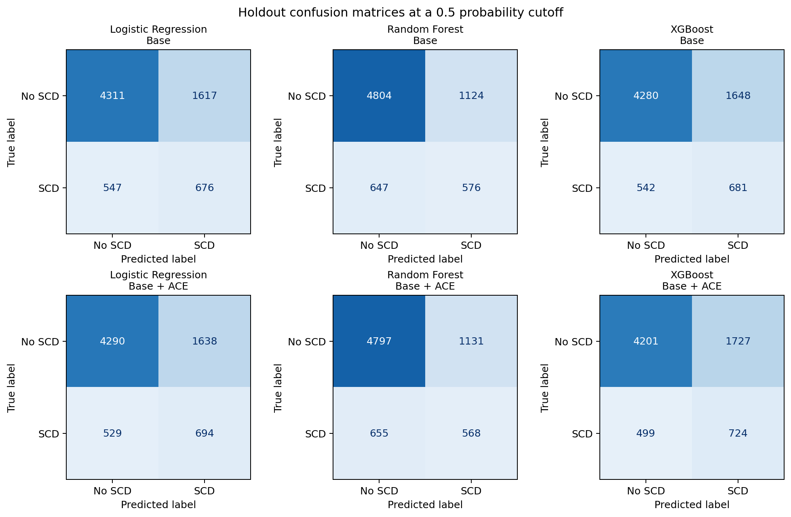
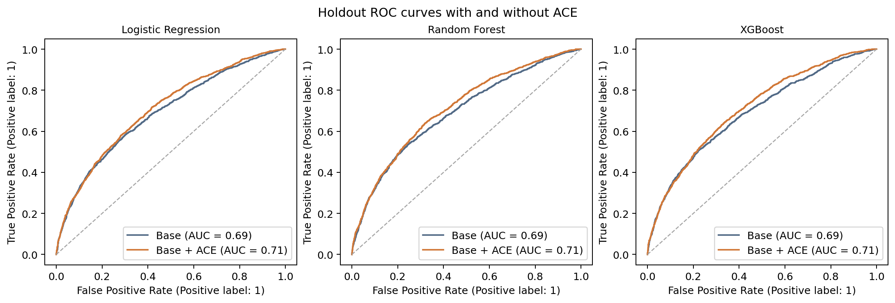
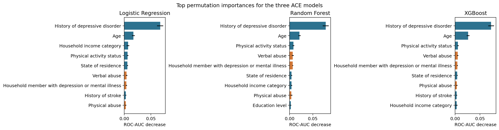
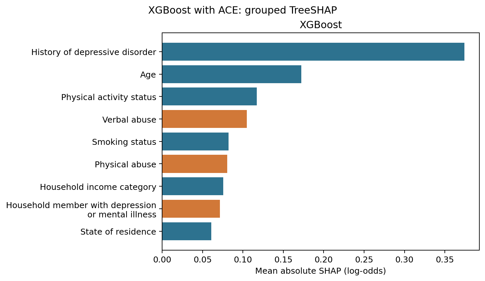

# Part D. Model Evaluation, Visualization and Interpretation

We evaluated whether 11 adverse childhood experience (ACE) items add predictive information for current self-reported subjective cognitive decline (SCD) beyond 14 base predictors.

## Holdout design

All six pipelines used the shared split: 28,603 training respondents and 7,151 test respondents (1,223 SCD-positive). Imputation, age scaling and one-hot encoding were fitted on training rows. We fixed settings before scoring the test set, using the Part B parameter CSV for the two full B models and the Part C CV CSV for the remaining configurations. The Part C Word report gives a different base random-forest configuration, so this analysis identifies the CSV as its source. Classification metrics use a probability cutoff of 0.5. The two B pipelines were refitted from their recorded settings in the evaluation environment.

Relative to the archived Part B predictions, the refitted full logistic regression and random forest differed on 3 and 343 test classifications, respectively.

The archived Part B F1 scores were 0.3907 for logistic regression and 0.3978 for random forest. The paired comparisons below use the six refits in one environment (scikit-learn 1.2.2 and XGBoost 3.1.3).

## Test-set performance

| Model | Features | Accuracy | Precision | Recall | F1 | ROC-AUC |
| --- | ---: | ---: | ---: | ---: | ---: | ---: |
| Logistic Regression | Base | 0.6974 | 0.2948 | 0.5527 | 0.3845 | 0.6894 |
| Logistic Regression | Base + ACE | 0.6970 | 0.2976 | 0.5675 | 0.3904 | 0.7065 |
| Random Forest | Base | 0.7523 | 0.3388 | 0.4710 | 0.3941 | 0.6910 |
| Random Forest | Base + ACE | 0.7502 | 0.3343 | 0.4644 | 0.3888 | 0.7117 |
| XGBoost | Base | 0.6937 | 0.2924 | 0.5568 | 0.3834 | 0.6916 |
| XGBoost | Base + ACE | 0.6887 | 0.2954 | 0.5920 | 0.3941 | 0.7122 |

Among the ACE models, XGBoost had the highest ROC-AUC (0.7122). XGBoost had the highest recall (0.5920).

With ACE, Logistic Regression identified 694 of 1,223 SCD cases and flagged 1,638 of 5,928 respondents without SCD.

With ACE, Random Forest identified 568 of 1,223 SCD cases and flagged 1,131 of 5,928 respondents without SCD.

With ACE, XGBoost identified 724 of 1,223 SCD cases and flagged 1,727 of 5,928 respondents without SCD.

The majority-class accuracy baseline is 82.90%. It identifies zero SCD cases.

## Incremental value of ACE

| Model | F1 change | F1 95% CI | AUC change | AUC 95% CI |
| --- | ---: | ---: | ---: | ---: |
| Logistic Regression | 0.0059 | [-0.0051, +0.0167] | 0.0171 | [+0.0102, +0.0245] |
| Random Forest | -0.0053 | [-0.0177, +0.0076] | 0.0207 | [+0.0126, +0.0293] |
| XGBoost | 0.0107 | [-0.0016, +0.0227] | 0.0206 | [+0.0128, +0.0288] |

Changes are computed as Base + ACE minus Base. Intervals are 95% paired percentile bootstrap intervals from 1,000 test-set resamples stratified by observed outcome. Each resample uses the same respondents for both feature sets. The intervals condition on the trained models and this cohort.

F1 increased for Logistic Regression, XGBoost. No model's 95% interval was entirely above zero.

ROC-AUC increased for Logistic Regression, Random Forest, XGBoost. The 95% interval was entirely above zero for Logistic Regression, Random Forest, XGBoost.

## Feature importance and SHAP

Permutation importance measures the reduction in test ROC-AUC when a raw survey variable is shuffled, with 10 repeats. Error bars show the standard deviation across shuffles. Each raw category is shuffled as a unit before encoding. Orange denotes ACE features. Correlated variables can share predictive information, which can reduce individual permutation scores.

Logistic Regression: History of depressive disorder, Age, Household income category had the largest mean permutation scores.

Random Forest: History of depressive disorder, Age, Physical activity status had the largest mean permutation scores.

XGBoost: History of depressive disorder, Age, Physical activity status had the largest mean permutation scores.

TreeSHAP summarizes XGBoost contributions on the raw log-odds scale over all test rows. One-hot levels are summed within each original survey variable before averaging absolute values. The three largest mean absolute contributions were History of depressive disorder, Age, Physical activity status.

## Scope of inference

This was an unweighted evaluation of a cross-sectional sample with complete SCD and ACE responses from 10 states. The results describe incremental classification of self-reported SCD in this holdout. Feature importances describe model behavior and support neither causal estimates nor estimates of future decline.
